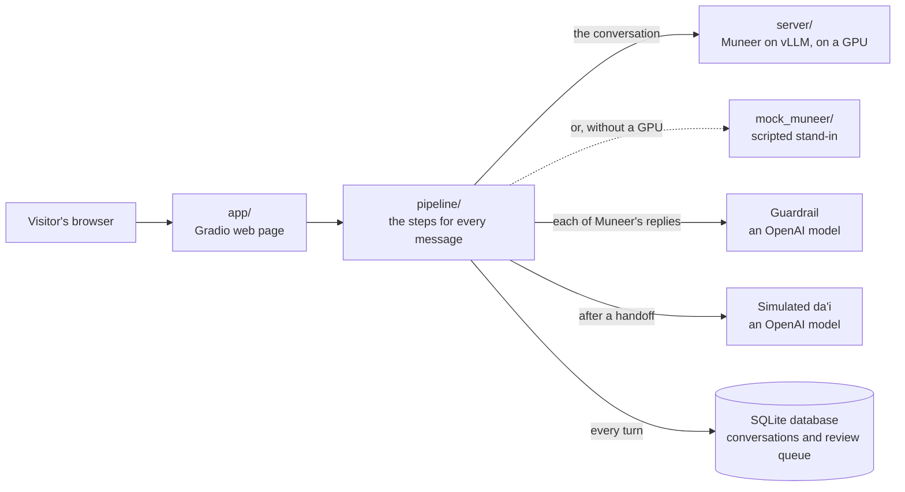

# Muneer (منير)

Muneer is an AI da'i: a fine-tuned language model that talks with non-Muslims about Islam in their own language. This
repository is the system around the model: a chat app, a pipeline that has a second model (the guardrail) check each of
Muneer's replies before the visitor sees it, the code to serve and deploy the model, and the configuration it was trained
with. The weights and the training data are private and not included.


## How it fits together



| Part | What it does |
|---|---|
| [**app/**](app/README.md) | Shows the chat, and every step behind each reply. Calls no model itself |
| [**pipeline/**](pipeline/README.md) | For each visitor message: gets Muneer's reply, fills in the organisation's details, has the guardrail label it, then shows it, hands the visitor to a da'i, or closes the conversation. Saves every turn |
| [**server/**](server/README.md) | Serves Muneer through an OpenAI-compatible API, behind an API key |
| [**mock_muneer/**](mock_muneer/README.md) | The same API with scripted replies, so everything else runs without a GPU |
| [**deploy/**](deploy/README.md) | The Docker images, and the launcher that runs the model and the app in one container |
| [**training/**](training/README.md) | The Axolotl configuration that fine-tuned the model the server serves |

## Quick start

**Recommended: use the deployed app at
[https://6sdqeqmw9mjnbs-7860.proxy.runpod.net](https://6sdqeqmw9mjnbs-7860.proxy.runpod.net/).** It runs the real
model, and there is nothing to install.

- **Demo video:** [https://youtu.be/EnnCmr6NhL0](https://youtu.be/EnnCmr6NhL0) shows how the solution works.
- **Documentation:**
  [Muneer - Documentation (Setup, Sources, Tools and Licenses)](https://drive.google.com/file/d/14A94FYYf9vwglfDHGkJX6UTsz8RKj980/view?usp=sharing),
  in Arabic: how to set up and run the solution, its live links and API, the sources of the training data, the tools
  used, and the rights and licences.
- **The model's API:** [https://6sdqeqmw9mjnbs-8000.proxy.runpod.net](https://6sdqeqmw9mjnbs-8000.proxy.runpod.net/)
  is OpenAI-compatible, with the base URL `https://6sdqeqmw9mjnbs-8000.proxy.runpod.net/v1` and the model `muneer`.
  Each call needs the API key (`MUNEER_API_KEY`). It is in the documentation above, the document submitted with the
  hackathon deliverables. See also
  [calling the model directly](deploy/README.md#calling-the-model-directly-optional).

> [!WARNING]
> The API serves the raw model, without the guardrail, so its replies reach you unchecked. To see Muneer with the
> guardrail, use the app.

To run it yourself, both ways below need Docker and an OpenAI API key, because the guardrail and the simulated da'i are
OpenAI models. From the repository root:

```bash
cp .env.example .env
```

### The all-in-one image: the real model

The recommended way to run it yourself: the real model and the app in one container. You need an NVIDIA GPU of 48 GB (24 GB with
`MUNEER_QUANTIZATION=fp8`), driver 580 or newer, and the weights in a private Hugging Face repo
([how](deploy/README.md#1-put-the-weights-in-a-private-hugging-face-repo)). Set `MUNEER_HF_REPO`, `HF_TOKEN` and
`OPENAI_API_KEY` in `.env`, then:

```bash
docker build -f deploy/all-in-one.Dockerfile -t muneer-all-in-one:v1 .
```

```bash
docker run --rm --gpus all -p 127.0.0.1:7860:7860 --env-file .env -v muneer-workspace:/workspace muneer-all-in-one:v1
```

Wait for `[all-in-one] Muneer is ready.`, then open http://127.0.0.1:7860. The first start downloads about 30 GB.

### No GPU: the mock

The mock is not the real model: it returns scripted replies, so you can try the interface. The guardrail and the
simulated da'i are still real. Set `OPENAI_API_KEY` in `.env`, then:

```bash
docker compose -f docker-compose.yml -f docker-compose.mock.yml up --build
```

Open http://127.0.0.1:7860 and try "What is Islam?", "Where is God?" (a planted error, handed off to the simulated
da'i) or "Please stop messaging me". Set `ADMIN_PASSCODE` in `.env` (at least 16 characters) to open the two Admin View
tabs.

The [deployment guide](deploy/README.md) covers RunPod and a third way, the model on RunPod with the app on a laptop.

## Repository map

| Path | What it holds |
|---|---|
| [`app/`](app/README.md) | The Gradio app and its four tabs |
| [`pipeline/`](pipeline/README.md) | Muneer's client, placeholder filling, the guardrail, the simulated da'i and the database |
| [`pipeline/prompts/`](pipeline/prompts/README.md) | The guardrail's and the simulated da'i's instructions |
| [`server/`](server/README.md) | The model server: the vLLM launcher, the API-key check, the sampling defaults, the chat template and Muneer's system prompt |
| [`mock_muneer/`](mock_muneer/README.md) | The scripted stand-in for the model server |
| [`deploy/`](deploy/README.md) | The three Dockerfiles, the all-in-one launcher and the deployment guide |
| [`training/`](training/README.md) | The fine-tuning configuration and the run that produced the model. The training data is private and not included |
| [`model/`](model/README.md) | Only a README: the model's weights are private, in a Hugging Face repository shown in a screenshot |
| [`docs/adr/`](docs/adr/README.md) | The main design decisions, and why |
| [`docs/images/`](docs/images/README.md) | The screenshots |
| `*/tests/` | Each folder's tests, with their own README. No GPU and no OpenAI calls |
| [`CONTEXT.md`](CONTEXT.md) | The vocabulary used in the code and the READMEs |
| [`.env.example`](.env.example) | The app's and the pipeline's settings, with defaults and comments. Copy it to `.env`. The model server's are in [`server/.env.example`](server/.env.example) |
| [`docker-compose.yml`](docker-compose.yml) | The app in Docker; [`docker-compose.mock.yml`](docker-compose.mock.yml) adds the mock |
| [`docker-compose.test.yml`](docker-compose.test.yml) | Runs every test in Linux: `docker compose -f docker-compose.test.yml run --rm tests` |
| [`requirements-dev.txt`](requirements-dev.txt), [`pytest.ini`](pytest.ini) | To run the tests natively: `pip install -r requirements-dev.txt`, then `python -m pytest` |
| [`LICENSE`](LICENSE) | The rights to the code, the model and the training data |

## Rights

The code, the model and the training data have different rights; see [`LICENSE`](LICENSE). The model's weights
and the training data are private and not in this repository.
