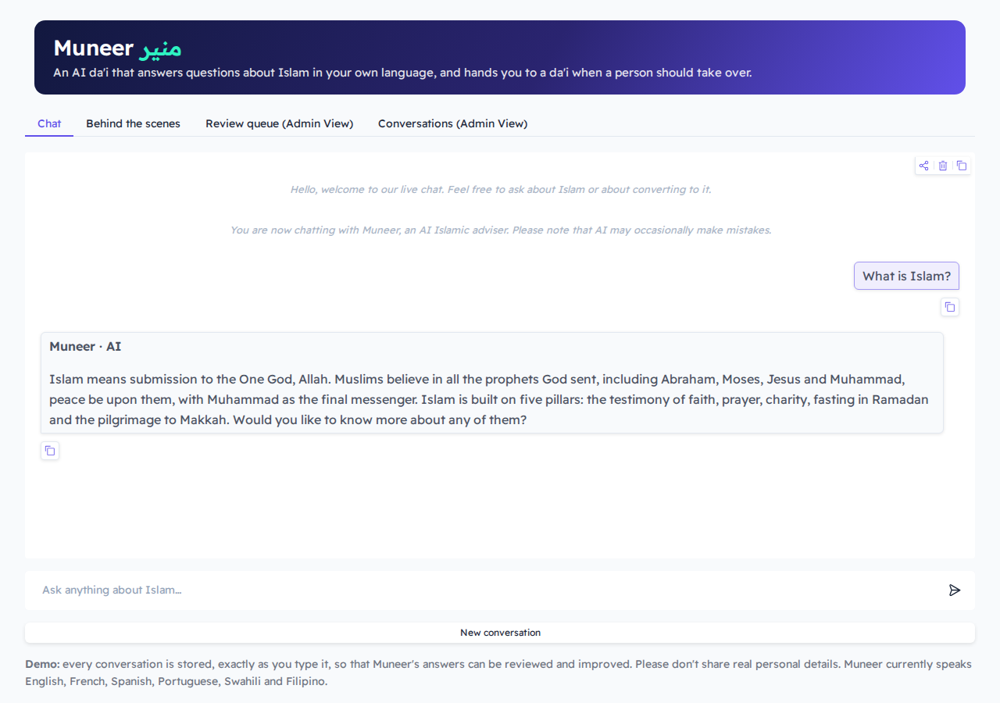
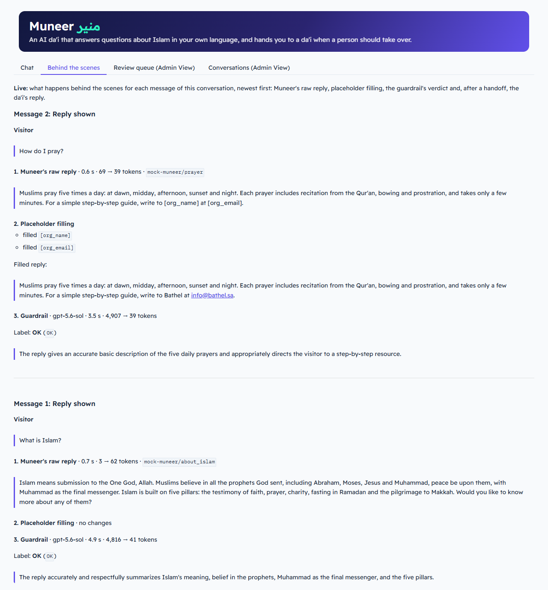
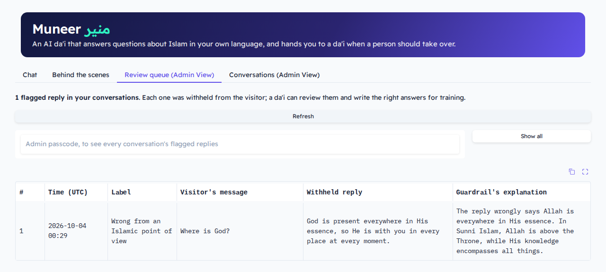
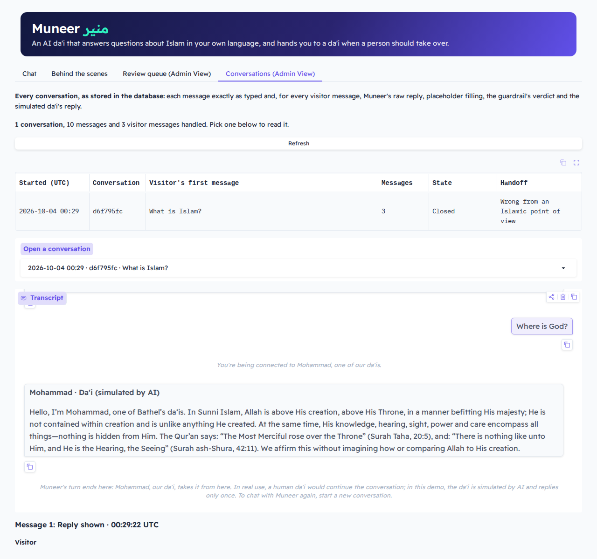

# app

The [Gradio](https://www.gradio.app) web page. It is a thin layer over the [pipeline](../pipeline/README.md): it passes
each visitor message to `Pipeline.handle()` and shows what comes back. It calls no model and writes nothing to the
database itself.

## Files

| File | What it does |
|---|---|
| [`__main__.py`](__main__.py) | `python -m app`: loads `.env`, builds the pipeline with `Pipeline.from_env()`, checks `ADMIN_PASSCODE` and serves the page |
| [`ui.py`](ui.py) | `build_ui()` lays out the four tabs and wires their events. The other functions turn pipeline objects into what the tabs show: `chat_messages`, `trace_markdown`, `review_view`, `conversations_view` and `conversation_detail` |
| [`requirements.txt`](requirements.txt) | Gradio and python-dotenv, plus the pipeline's packages |
| [`tests/`](tests/README.md) | What each tab shows, and how the events are wired |

## The four tabs

| Tab | What it shows | Built from |
|---|---|---|
| **Chat** | The conversation. Each message says who wrote it: "Muneer · AI" or "Mohammad · Da'i (simulated by AI)" | `Conversation.messages` |
| **Behind the scenes** | Each turn's steps, newest first: the raw reply, placeholder filling, the verdict and the simulated da'i, with times and tokens | `Conversation.traces` |
| **Review queue (Admin View)** | Flagged replies. A visitor sees only their own; the admin passcode shows them all | `ReviewQueue` |
| **Conversations (Admin View)** | Every stored conversation, with its transcript and its turns. Locked until the admin passcode is entered | `ConversationLog` |

| Chat | Behind the scenes |
|---|---|
|  |  |
| **Review queue** | **Conversations** |
|  |  |

## The events

| Event | Handler | What it does |
|---|---|---|
| The page loads | `start` | `pipeline.start()`: a new conversation with the welcome and the AI disclosure |
| The visitor sends a message | `accept` | Shows the message at once and locks the input. It skips the queue |
| Then | `respond` | Runs `pipeline.handle()` in Gradio's queue, `APP_CONCURRENCY` at a time, then shows the new messages and the trace. Unlocks the input unless the conversation closed |
| **New conversation** | `start` | Cancels a `respond` still running, so a late reply never lands in the new chat |
| A tab opens, or **Refresh** | `load_review`, `load_conversations` | Reads the database for that tab |
| A conversation is picked | `show_conversation` | Shows its transcript and every turn's steps |
| A passcode is entered | `unlocker` | Checks the admin passcode. Either tab's box unlocks both |

## The admin passcode

- **`ADMIN_PASSCODE`** opens the two Admin View tabs. It must be at least 16 characters: `admin_passcode()` stops the
  app otherwise. Left empty, the Conversations tab stays locked, and the review queue shows each visitor only their own.
- **Unlocking is kept on the server,** per page, in a `gr.State`, and checked before every read. A refresh locks it
  again.
- **Each tab sets its own passcode box when it opens,** because Gradio drops visibility changes for a tab that hasn't
  been opened yet.

## Safety in the page

- **Typed HTML never runs:** `_inert()` escapes it in the chat and the turn steps, and the tables show their cells as
  plain text.
- **The page id is a hash:** `page_id()` stores a one-way hash of Gradio's session, never the session itself.
- **Nothing extra is exposed:** every event is `api_visibility="private"`, and analytics, run history, error details
  and footer links are off.

## Settings

| Setting | Default | What it does |
|---|---|---|
| `APP_HOST` | `127.0.0.1` | The address to listen on; `0.0.0.0` in Docker |
| `APP_PORT` | `7860` | The port |
| `APP_CONCURRENCY` | `8` | Visitor messages processed at once |
| `ADMIN_PASSCODE` | Empty | Opens the Admin View tabs |

The app also reads every pipeline setting. All of them are in [`.env.example`](../.env.example).

## Run it

Without Docker, with Python 3.11 or later, from the repository root. `.env` needs `OPENAI_API_KEY`;
`.env.example` already points `MUNEER_BASE_URL` at the mock.

```bash
pip install -r requirements-dev.txt
```

```bash
python -m mock_muneer
```

Then, in a second terminal:

```bash
python -m app
```

Open http://127.0.0.1:7860. To run it in Docker, see [deploy](../deploy/README.md).
