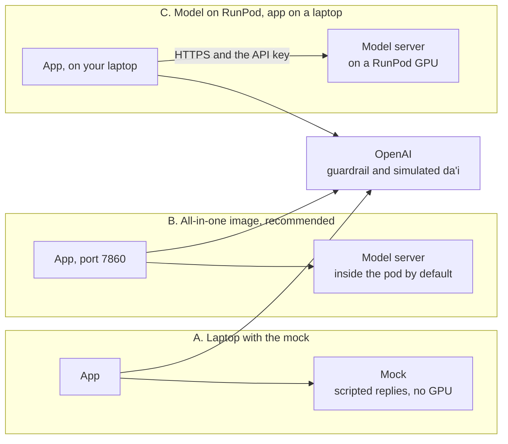

# deploy

The Docker images, and the launcher that runs the model and the app in one container. There are three ways to run
Muneer. **B, the all-in-one image, is recommended:** it runs the real model and the app together.

## The three ways



| | A. Laptop with the mock | B. All-in-one image (recommended) | C. Model on RunPod, app on a laptop |
|---|---|---|---|
| **Use it for** | Trying the interface without a GPU | The public demo on RunPod, or the real model on your own GPU | Working on the app against the real model |
| **The model** | The mock, which is not Muneer: scripted replies | Muneer | Muneer |
| **GPU** | None | 48 GB, or 24 GB with `MUNEER_QUANTIZATION=fp8` | The same, on RunPod |
| **Images** | `muneer-app` | `muneer-all-in-one` | `muneer-server` and `muneer-app` |
| **Public port** | None | 7860: the app. Optional: 8000, the model server, behind its API key | 8000: the model server, behind its API key |

Every way needs `OPENAI_API_KEY`, because the guardrail and the simulated da'i are OpenAI models.

## Files

| File | Image | What it does |
|---|---|---|
| [`all-in-one.Dockerfile`](all-in-one.Dockerfile) | `muneer-all-in-one` | vLLM's official image, plus the app with its own Python 3.14. Starts `all_in_one.py` |
| [`all_in_one.py`](all_in_one.py) | | Starts the model server and the app, watches them, and restarts them |
| [`app.Dockerfile`](app.Dockerfile) | `muneer-app` | The app, or the mock. Python 3.14, as an unprivileged user |
| [`server.Dockerfile`](server.Dockerfile) | `muneer-server` | vLLM 0.29.0 and [`server/launch.py`](../server/README.md) |
| [`constraints.txt`](constraints.txt) | | The app's package versions the tests passed with, pinned in the app and all-in-one images |
| [`tests/`](tests/README.md) | | Tests for `all_in_one.py` |

## How `all_in_one.py` works

A RunPod pod runs one container, so this script does what Docker Compose does on a laptop
([ADR 0006](../docs/adr/0006-public-demo-in-one-runpod-pod.md)).

1. **Checks the settings** (`check_settings`): the container's variables, over the defaults in `.env.example`. A
   missing or invalid one stops it with `error: …` before anything starts.
2. **Plans the two processes** (`build_plan`), each with only the secrets it needs:

   | | Model server | App |
   |---|---|---|
   | **Runs** | `server/launch.py`, then vLLM | `python -m app` |
   | **As** | root | the unprivileged account `muneer` |
   | **Listens on** | `127.0.0.1:8000`, inside the container only; `0.0.0.0:8000` when the pod sets `MUNEER_API_KEY` | `0.0.0.0:7860`, published |
   | **Gets** | `HF_TOKEN`, which the launcher drops before vLLM starts | `OPENAI_API_KEY`, `ADMIN_PASSCODE` and the settings `.env.example` names |
   | **Never gets** | `OPENAI_API_KEY`, `ADMIN_PASSCODE` | `HF_TOKEN` |

   The two share an API key: the pod's `MUNEER_API_KEY` if it sets one
   ([calling the model directly](#calling-the-model-directly-optional)), otherwise a fresh one made at each start.
   `RUNPOD_API_KEY` reaches neither.
3. **Prepares the volume** at `/workspace`: closes the weights and cache folders to the app's account, and hands it the
   database's own folder (`DATABASE_PATH`, by default `/workspace/data/muneer.sqlite3`). Some storage won't hand a
   folder to another account: a RunPod volume can be network storage (NFS). That folder is then opened to every
   account instead.
4. **Watches both** (`Supervisor`): a health check every 10 s. When both answer, it logs `Muneer is ready`. A process
   that exits is started again after 5 s, then longer, up to 5 minutes. One that stops answering for 6 checks in a row
   gets SIGTERM, and is killed at the next check if it is still running. When the container stops, both get SIGTERM
   and 7 s to exit.

`MODEL_SERVER=mock` runs the mock in place of vLLM, to try the image without a GPU.

## Where each setting goes

| Setting | A | B on RunPod | C |
|---|---|---|---|
| `OPENAI_API_KEY` | `.env` | Secret `openai_api_key` | `.env` |
| `HF_TOKEN` | Not needed | Secret `hf_token` | Secret `hf_token`, on the pod |
| `MUNEER_HF_REPO` | Not needed | Pod variable | Pod variable |
| `MUNEER_API_KEY` | Not needed | Made at each start. Optional: secret `muneer_api_key`, to call the model directly | Secret `muneer_api_key`, and the same value in `.env` |
| `MUNEER_BASE_URL` | Set by Docker Compose | Set by `all_in_one.py` | `.env`: the pod's address |
| `ADMIN_PASSCODE` (optional) | `.env` | Secret `admin_passcode` | `.env` |

Every other setting has a default in [`.env.example`](../.env.example). To run B on your own machine, put the B
settings in `.env`.

## A. Laptop with the mock

The mock is not the real model: its replies are scripted ([mock_muneer](../mock_muneer/README.md)). The guardrail and
the simulated da'i are still real OpenAI models.

```bash
cp .env.example .env
```

Set `OPENAI_API_KEY` in `.env`, then start the app and the mock:

```bash
docker compose -f docker-compose.yml -f docker-compose.mock.yml up --build
```

Open http://127.0.0.1:7860. The database is kept in the `database` Docker volume. Stop both with:

```bash
docker compose down --remove-orphans
```

## B. The all-in-one image (recommended)

### On your own GPU machine

You need an NVIDIA GPU of 48 GB (24 GB with `MUNEER_QUANTIZATION=fp8`), driver 580 or newer, Docker with GPU support,
and the weights in a private Hugging Face repo ([step 1 below](#1-put-the-weights-in-a-private-hugging-face-repo)). Set
`MUNEER_HF_REPO`, `HF_TOKEN` and `OPENAI_API_KEY` in `.env`, without quotes around the values.

```bash
docker build -f deploy/all-in-one.Dockerfile -t muneer-all-in-one:v1 .
```

```bash
docker run --rm --gpus all -p 127.0.0.1:7860:7860 --env-file .env -v muneer-workspace:/workspace muneer-all-in-one:v1
```

Wait for `[all-in-one] Muneer is ready.`, then open http://127.0.0.1:7860. The first start downloads about 30 GB of
weights into the `muneer-workspace` volume, with the caches and the database; later starts reuse them.

### On RunPod: the public demo

Do [Preparing RunPod](#preparing-runpod-for-b-and-c) first. Then build and push the image:

```bash
docker build -f deploy/all-in-one.Dockerfile -t <dockerhub-user>/muneer-all-in-one:v1 .
```

```bash
docker push <dockerhub-user>/muneer-all-in-one:v1
```

Create a GPU pod in the RunPod console:

| Setting | Value |
|---|---|
| Container image | `docker.io/<dockerhub-user>/muneer-all-in-one:v1` |
| Container disk | 40 GB |
| Volume disk | 80 GB, mounted at `/workspace` |
| Expose HTTP ports | `7860`, plus `8000` only to [call the model directly](#calling-the-model-directly-optional) |
| Environment variables | `MUNEER_HF_REPO` = `<hf-user>/muneer-14b`<br/>`HF_TOKEN` = `{{ RUNPOD_SECRET_hf_token }}`<br/>`OPENAI_API_KEY` = `{{ RUNPOD_SECRET_openai_api_key }}`<br/>Optional: `ADMIN_PASSCODE` = `{{ RUNPOD_SECRET_admin_passcode }}`<br/>Optional, with port `8000`: `MUNEER_API_KEY` = `{{ RUNPOD_SECRET_muneer_api_key }}` |
| GPU | One from the [table below](#4-choose-a-gpu), filtered for CUDA 13.0 or higher |

Or, with [runpodctl](https://github.com/runpod/runpodctl) 2.x (on Windows, from Git Bash):

```bash
runpodctl pod create --name muneer-demo --image docker.io/<dockerhub-user>/muneer-all-in-one:v1 --gpu-id "NVIDIA A40" --gpu-count 1 --cloud-type SECURE --container-disk-in-gb 40 --volume-in-gb 80 --ports "7860/http" --min-cuda-version 13.0 --ssh=false --env '{"MUNEER_HF_REPO":"<hf-user>/muneer-14b","HF_TOKEN":"{{ RUNPOD_SECRET_hf_token }}","OPENAI_API_KEY":"{{ RUNPOD_SECRET_openai_api_key }}"}'
```

The first start takes 10 to 30 minutes. It is ready when the pod's log says
`[all-in-one] Muneer is ready: https://<pod-id>-7860.proxy.runpod.net`. That address is the demo link.

### Calling the model directly (optional)

For an evaluation, or any client that should reach Muneer without the app, the same pod can serve the model's API.
Set both when you create the pod, because editing a pod later restarts it:

- **Expose HTTP ports** `7860,8000` (with runpodctl, `--ports "7860/http,8000/http"`).
- **`MUNEER_API_KEY`** = `{{ RUNPOD_SECRET_muneer_api_key }}`, a random value of at least 32 characters
  ([step 3](#3-store-the-secrets-in-runpod)).

The log then says `The model's API is open to callers with MUNEER_API_KEY, at https://<pod-id>-8000.proxy.runpod.net/v1`.
Check it with the [smoke test](../server/README.md#run-it), then call it like any OpenAI-compatible API, with the model
name `muneer`.

- **The calls skip the pipeline:** no guardrail, no placeholder filling, and nothing is saved in the database.
- **They share the GPU with the demo's visitors,** so replies slow down while a batch of calls runs.
- **To close it,** remove port `8000` and `MUNEER_API_KEY` from the pod. It restarts; the weights stay on the volume.

## C. Model on RunPod, app on a laptop

App changes then take seconds, without reloading the model
([ADR 0003](../docs/adr/0003-model-on-runpod-app-in-local-docker.md)). Do
[Preparing RunPod](#preparing-runpod-for-b-and-c) first.

```bash
docker build -f deploy/server.Dockerfile -t <dockerhub-user>/muneer-server:v1 .
```

```bash
docker push <dockerhub-user>/muneer-server:v1
```

Create the pod as in B, with image `docker.io/<dockerhub-user>/muneer-server:v1`, port `8000`, and the variables
`MUNEER_HF_REPO`, `HF_TOKEN` and `MUNEER_API_KEY` = `{{ RUNPOD_SECRET_muneer_api_key }}`. Once
`https://<pod-id>-8000.proxy.runpod.net/health` answers, check it with the
[smoke test](../server/README.md#run-it), then point the app at it in `.env`:

```ini
MUNEER_BASE_URL=https://<pod-id>-8000.proxy.runpod.net/v1
MUNEER_API_KEY=<muneer-api-key>
```

```bash
docker compose up -d --build
```

## Preparing RunPod (for B and C)

Do these once.

### 1. Put the weights in a private Hugging Face repo

From the machine with the fine-tuned weights (what [training](../training/README.md) writes to its `output_dir`),
signed in with `hf auth login`:

```bash
hf repos create <hf-user>/muneer-14b --private
```

```bash
hf upload <hf-user>/muneer-14b <path-to-weights> . --exclude "trainer_state.json" --exclude "training_args.bin" --exclude "tokens_state.json"
```

Then create a fine-grained, **read-only** token for that repo at
[huggingface.co/settings/tokens](https://huggingface.co/settings/tokens). The server only downloads.

### 2. Sign in to Docker Hub

RunPod pulls images from a registry. The images hold no weights and no secrets.

```bash
docker login
```

### 3. Store the secrets in RunPod

In the console, under **Secrets**. A pod refers to one as `{{ RUNPOD_SECRET_<name> }}`, so the value never shows in its
settings.

| Secret | Value | Used by |
|---|---|---|
| `hf_token` | The read-only Hugging Face token | B and C |
| `openai_api_key` | Your OpenAI key, with a monthly spending limit | B |
| `admin_passcode` | Optional: a random value of at least 16 characters | B |
| `muneer_api_key` | The model server's key, at least 32 characters for B | C, and B to call the model directly |

Make a random value with `python -c "import secrets; print(secrets.token_urlsafe(32))"`.

### 4. Choose a GPU

The weights take about 30 GB, so the model needs 48 GB of GPU memory. Always filter for **CUDA 13.0 or higher**: the
images need NVIDIA driver 580 or newer. Prices per hour, checked on 4 Oct 2026:

| GPU | Memory | Secure Cloud | Community Cloud |
|---|---|---|---|
| `NVIDIA A40` | 48 GB | $0.49 | $0.35 |
| `NVIDIA RTX A6000` | 48 GB | $0.53 | $0.33 |
| `NVIDIA L40S` | 48 GB | $1.09 | $0.79 |
| `NVIDIA A100 80GB PCIe` | 80 GB | $1.59 | $1.19 |

Secure Cloud runs in data centres; use it for a demo that has to stay up.

## Keeping the demo up

- **Leave the pod running.** A stopped pod can come back without a GPU, and a new pod gets a new address.
- **To update it,** push a new tag (`:v2`, `:v3`…) and change the pod's image. Always use a new tag: a pod can keep a
  cached copy of one it has pulled. Everything under `/workspace`, the weights and the database included, survives.
- **The logs** say what happened to each message, never what was said.
- **Before terminating the pod,** copy `/workspace/data/muneer.sqlite3` off it if you want to keep the conversations.

## Troubleshooting

| Symptom | Fix |
|---|---|
| A CUDA or driver error at start | The host's driver is older than 580. Redeploy with the CUDA 13.0 filter |
| `error: Set OPENAI_API_KEY` or `Set MUNEER_HF_REPO` | A pod variable or its secret is missing |
| `… holds a RunPod secret reference` | The secret named in `{{ RUNPOD_SECRET_… }}` doesn't exist |
| `MUNEER_API_KEY opens the model's API, so it must be at least 32 characters` | Make a longer key ([step 3](#3-store-the-secrets-in-runpod)), or remove the variable to keep the model inside the pod |
| `DATABASE_PATH must be in a folder of its own` | Point it at its own folder under `/workspace`, such as the default `data/muneer.sqlite3` |
| 401, 403 or "repository not found" while fetching | `HF_TOKEN` can't read the repo |
| Out of GPU memory | Use a 48 GB GPU, or set `MUNEER_QUANTIZATION=fp8` |
| Every message gets "please send it again" | B: the model is still loading. C: `MUNEER_BASE_URL` or `MUNEER_API_KEY` doesn't match the pod; run the smoke test |
| C: HTTP 524, or slow replies time out | RunPod's proxy cuts requests at about 100 s. Lower `MUNEER_MAX_OUTPUT_TOKENS` or `MUNEER_MAX_NUM_SEQS` on the pod |
| The Conversations tab is locked | Set `ADMIN_PASSCODE`, then restart the app |
| The review queue or the conversation log is switched off | The app couldn't open the database. The log line `The database can't be opened (…)` says why |
