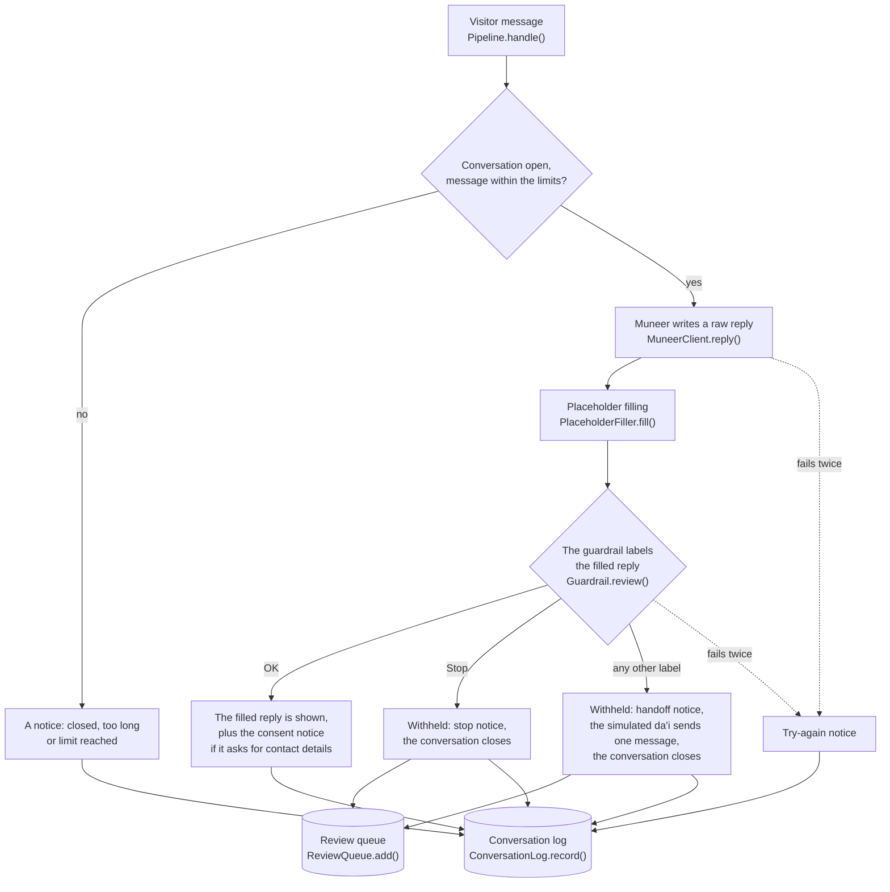

# pipeline

The steps run for every visitor message, from Muneer writing a reply to the visitor seeing a message. Its one rule:
none of Muneer's replies reaches the visitor before the guardrail has checked it. The [app](../app/README.md) calls it; it calls
Muneer's API, OpenAI and the database.

Words such as *raw reply*, *filled reply*, *verdict* and *handoff* are defined in [CONTEXT.md](../CONTEXT.md).

## One turn

`Pipeline.handle(conversation, text)` runs one turn. It updates the `Conversation` in place and returns the messages it
added, with a `Trace` of every step.



Each turn ends with one `Trace.outcome`:

| Outcome | What happened |
|---|---|
| `delivered` | Labelled OK and shown |
| `handed_off` | Withheld, and the simulated da'i took over |
| `stopped` | Labelled Stop, and the conversation closed |
| `dai_replied` | The da'i answered a later message, after being unavailable |
| `error` | A step failed twice, and the visitor was asked to send the message again |
| `rejected` | The message was empty, too long, or over the message limit |
| `closed` | The message was sent to a closed conversation |

## Files

| File | Main names | What it does |
|---|---|---|
| [`pipeline.py`](pipeline.py) | `Pipeline`, `Conversation`, `TurnResult` | Runs a turn. A `Conversation` holds its state, the messages the visitor sees, Muneer's raw history and the traces |
| [`trace.py`](trace.py) | `Trace` | What each step of one turn produced, and the outcome |
| [`muneer.py`](muneer.py) | `MuneerClient` | Calls Muneer's OpenAI-compatible API |
| [`placeholders.py`](placeholders.py) | `PlaceholderFiller`, `FilledReply` | Turns a raw reply into a filled reply |
| [`guardrail.py`](guardrail.py) | `Guardrail`, `Label`, `Verdict` | Labels a filled reply |
| [`simulated_dai.py`](simulated_dai.py) | `SimulatedDai`, `Handoff` | The da'i's one message after a handoff |
| [`llm.py`](llm.py) | `parse_with_retry` | The OpenAI call the guardrail and the da'i share: a strict JSON schema and one retry |
| [`conversation_log.py`](conversation_log.py) | `ConversationLog` | Saves and reads every conversation, message and turn |
| [`review_queue.py`](review_queue.py) | `ReviewQueue`, `mask` | Saves and lists flagged replies, with emails and phone numbers masked |
| [`database.py`](database.py) | `connect`, `database_path` | Opens the SQLite file the two above share |
| [`consent.py`](consent.py) | `asks_for_contact_details` | Spots a request for contact details, in six languages |
| [`notices.py`](notices.py) | | The text of every notice but the consent notice, which is in `consent.py` |
| [`conversation.py`](conversation.py) | `Message` | One message: who wrote it (`visitor`, `muneer`, `dai` or `notice`) and its text |
| [`config.py`](config.py) | `env_*`, `openai_client` | Reads and checks the settings |
| [`requirements.txt`](requirements.txt) | | The pipeline's one package: `openai` |
| [`prompts/`](prompts/README.md) | | The guardrail's and the da'i's instructions |
| [`tests/`](tests/README.md) | | The pipeline's tests |

## The steps

### 1. Muneer's reply: `muneer.py`

- **Only the conversation is sent:** visitor messages as `user`, Muneer's earlier **raw** replies as `assistant`. No
  system prompt and no sampling setting: the [model server](../server/README.md#chat-format-and-sampling) adds
  Muneer's system prompt and its sampling defaults ([ADR 0002](../docs/adr/0002-no-system-prompt-for-muneer.md)).
- **Only replies labelled OK join Muneer's history,** so a message sent again after a failure starts clean.
- **The history is trimmed** to the latest messages that fit in 12,000 characters, starting with a visitor message.
- **One retry** after an error or an empty reply.
- **`MUNEER_BASE_URL`** points at the [model server](../server/README.md) or at the [mock](../mock_muneer/README.md).

### 2. Placeholder filling: `placeholders.py`

Muneer writes a placeholder where a reply needs the organisation's own details: `[ai_name]` for the assistant's name,
`[org_name]` for the organisation's name and `[org_email]` for its email. So one model can serve many organisations.
Two settings drive it, each as JSON on one line:

| Setting | What it holds | Example |
|---|---|---|
| `PLACEHOLDERS` | The organisation profile | `{"ai_name": "Muneer", "org_name": "Bathel", "org_email": "info@bathel.sa"}` |
| `REPLACEMENT_RULES` | Fixed text the model learned, and what to show instead | `[{"find": "Daee", "replace": "Muneer"}]` |

- **Rules run first, then placeholders,** so a rule can turn learned text into a placeholder.
- **Rules match whole words** by default, left to right. Where two match at the same place, the first listed wins. A
  rule's output is never rewritten, so filling twice changes nothing.
- **A rule leaves alone text that already reads like its replacement,** a placeholder counting as its value. So with
  `ai_name` set to Muneer, a rule that writes "Muneer, an AI Islamic Advisor" doesn't touch "[ai_name], an AI Islamic
  Advisor", and the assistant isn't named twice.
- **Only lower_snake_case names with an underscore are placeholders,** so citations such as `[Muslim]`, and the
  words translators add inside quoted verses, such as `[so]`, are left alone.
- **A placeholder with no value** is removed and reported in the trace.

The rules shipped in [`.env.example`](../.env.example) replace an old persona name the model learned with Muneer's.

### 3. The guardrail: `guardrail.py`

An OpenAI model (`GUARDRAIL_MODEL`, `gpt-5.6-sol` with low reasoning by default) reads the conversation as the visitor
saw it and returns a `Verdict`: one `Label` and a short explanation. It only classifies; it never writes a reply. Its
instructions are in [`prompts/guardrail.md`](prompts/guardrail.md).

| Label | Code | Then |
|---|---|---|
| OK | `OK` | The reply is shown |
| Wrong from an Islamic point of view | `wrong_from_islamic_point_of_view` | Handoff |
| Improper response | `response_wrong` | Handoff |
| Controversial topic | `wrong_controversial` | Handoff |
| Transfer requested | `wrong_transfer_requested` | Handoff |
| Visitor upset | `wrong_transfer_upset` | Handoff |
| Stop | `STOP` | The conversation closes |

- **It reviews the filled reply,** exactly what the visitor would see
  ([ADR 0004](../docs/adr/0004-guardrail-reviews-the-filled-reply.md)).
- **Nothing is streamed,** because nothing is shown before the verdict
  ([ADR 0001](../docs/adr/0001-guardrail-checks-replies-before-delivery.md)).
- **Any label but OK** saves the reply to the review queue.
- **Bounded cost:** the last 20 messages, the fixed instructions first (so OpenAI caches them), at most 4,000 output
  tokens, and `store` off. Measured with `gpt-5.6-sol`, a review took 2 to 3.5 seconds.
- **A refused setting is dropped:** if a model doesn't take a temperature or a reasoning effort, `llm.py` sends the
  request again without it, and leaves it out from then on.

### 4. The simulated da'i: `simulated_dai.py`

The simulated da'i is not a person and not Muneer: it is another OpenAI model (`SIMULATED_DAI_MODEL`) that stands in
for a human da'i, only to show the handoff in the demo ([ADR 0005](../docs/adr/0005-simulated-dai-after-handoff.md)).


- **What it gets:** the conversation without notices (the last 20 messages), the handoff notes (the label, the
  guardrail's explanation and the withheld reply), its name (`SIMULATED_DAI_NAME`) and `org_name` from the profile.
- **One message,** then the conversation closes. The app labels it "Da'i (simulated by AI)".
- **No links or emails:** `has_link_or_email` checks every message. One with a link is asked for again once; a second
  counts as the da'i being unavailable.
- **Not checked by the guardrail,** because it stands in for a person.
- **If it is unavailable** (it fails twice, or sends an empty message), the conversation stays in the `dai` state, so
  the visitor's next message goes to the da'i.

### 5. Notices: `notices.py` and `consent.py`

Notices are the platform's own messages: the welcome, the AI disclosure, and the handoff, stop, closed and try-again
notices. Muneer never writes them. After any Muneer or da'i message that asks for contact details,
`asks_for_contact_details` adds the consent notice (`CONSENT_NOTICE`).

## Conversation states

| State | The next visitor message goes to | Changes to |
|---|---|---|
| `muneer` | Muneer | `dai` after a handoff label; `closed` after Stop or the message limit |
| `dai` | The simulated da'i | `closed` once the da'i replies |
| `closed` | Nobody: the visitor gets the closed notice | |

## The database

One SQLite file (`DATABASE_PATH`, by default `data/muneer.sqlite3`), shared by two writers:

| Table | One row per | Written by |
|---|---|---|
| `conversations` | Conversation: its state, handoff label, page (hashed) and times | `ConversationLog` |
| `messages` | Message the visitor saw, notices included | `ConversationLog` |
| `turns` | Turn: every step's text, model, time and tokens, the verdict and the outcome | `ConversationLog` |
| `flagged_replies` | Flagged reply, with emails and phone numbers masked | `ReviewQueue` |

- **Exactly as typed:** the conversation log masks nothing; only the review queue masks
  ([ADR 0007](../docs/adr/0007-every-conversation-is-stored.md)).
- **Saved after every turn,** in one transaction, refused messages included. A conversation is first saved with its
  first visitor message, so a page that is opened and left adds nothing.
- **It never breaks the chat:** if the file can't be opened at startup, the pipeline runs without it
  (`conversation_log` and `review_queue` are `None`). A failed save is logged, and the missed turn is saved with the
  next one.
- **One call at a time:** `connect()` opens a short-lived connection for each call, behind a lock in the process.
- **A file from an older version** turns the conversation log off at startup, with a line in the log; the chat and the
  review queue still run. Delete or move the file to start an empty one.

Any SQLite tool can read it while the app runs:

```bash
python -m sqlite3 data/muneer.sqlite3
```

```sql
SELECT created_at, outcome, guardrail_label, visitor_message FROM turns ORDER BY id DESC LIMIT 20;
```

## Limits and failures

| Limit | Value | Setting |
|---|---|---|
| Characters per visitor message | 2,000 | `MAX_MESSAGE_CHARS` |
| Visitor messages per conversation | 40, then it closes | `MAX_VISITOR_MESSAGES` |
| Attempts per call to Muneer, the guardrail or the da'i | 2 | Fixed |
| Time per attempt | Muneer 60 s, guardrail 20 s, da'i 30 s | `*_TIMEOUT_SECONDS` |

Every failure ends with a notice, so the chat never locks:

| When | The visitor sees |
|---|---|
| Muneer or the guardrail fails twice, or anything unexpected happens | The try-again notice. An unchecked reply is never shown |
| The da'i fails twice, or sends an empty message | The da'i-busy notice; the next message goes to the da'i |
| The database fails | Nothing: the chat goes on |
| A setting is missing or invalid | The app doesn't start, and the error names the setting |

## Settings

Every setting is an environment variable, listed with its default and a comment in [`.env.example`](../.env.example).
The ones that matter most here:

| Setting | What it sets |
|---|---|
| `MUNEER_BASE_URL`, `MUNEER_API_KEY` | Where Muneer's API is, and its key |
| `OPENAI_API_KEY` | Required: the guardrail and the simulated da'i |
| `GUARDRAIL_MODEL`, `SIMULATED_DAI_MODEL` | Which OpenAI models they use |
| `PLACEHOLDERS`, `REPLACEMENT_RULES` | The organisation profile and the replacement rules |
| `DATABASE_PATH` | The SQLite file |

## Use it from Python

With the mock running (`python -m mock_muneer`) and `OPENAI_API_KEY` in `.env`, from the repository root:

```python
import os

from dotenv import load_dotenv

from pipeline.pipeline import Pipeline

load_dotenv(".env")
pipeline = Pipeline.from_env(os.environ)  # also opens the database
conversation = pipeline.start()  # the welcome and the AI disclosure
result = pipeline.handle(conversation, "How do I pray?")  # one turn, saved to the database
for message in result.messages:
    print(f"{message.speaker}: {message.text}")
print(result.trace.outcome, conversation.state)
```

`pipeline.conversation_log` reads it back: `messages(id)`, `turns(id)` and `recent()`.
